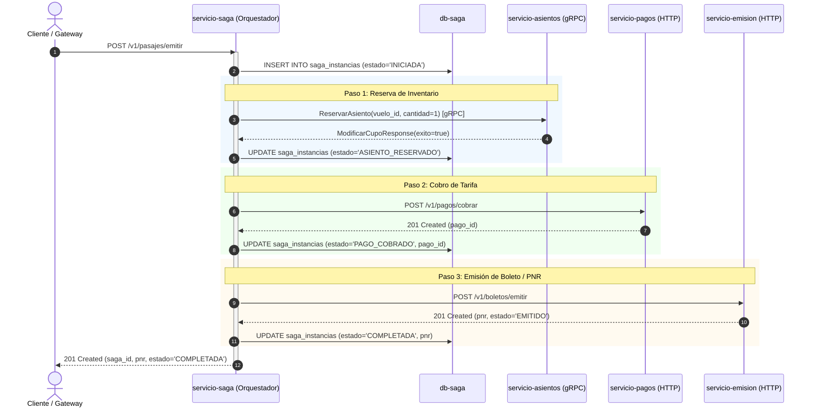
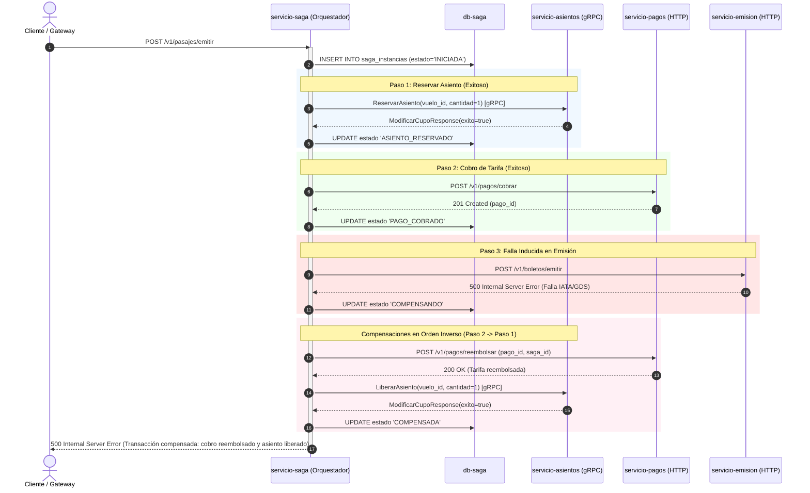
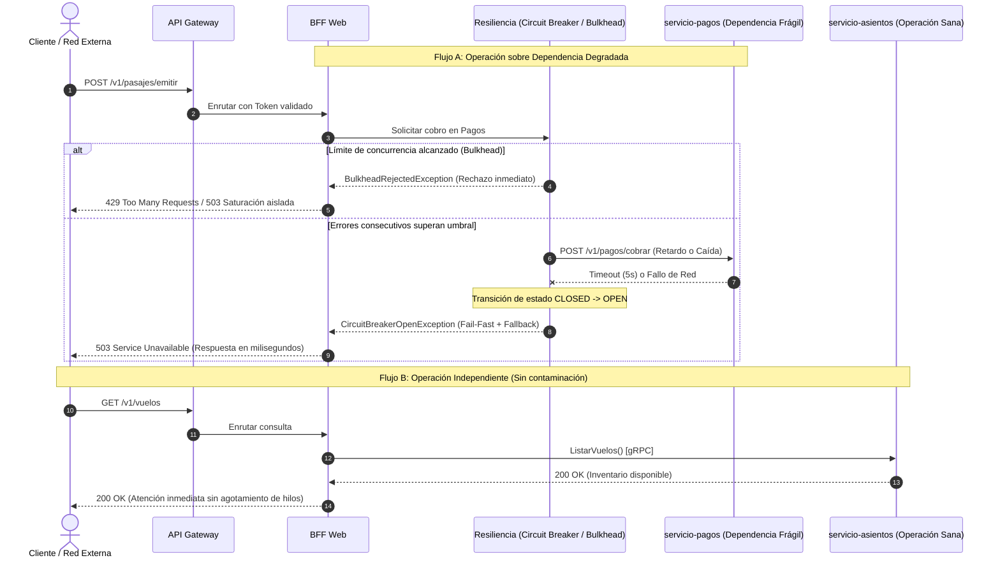

# Diagramas de Secuencia — AustralAir (Unidad 3)

Este documento contiene los diagramas de secuencia de los escenarios evaluados para la arquitectura orientada a eventos/Saga y resiliencia.

---

## 1. Escenario 1: Camino Feliz (Éxito Completo)

Ejecución nominal de la operación «Emitir un pasaje» coordinando Asientos, Pagos y Emisión.

---

## 2. Escenario 2: Fallo en Último Paso y Compensación en Orden Inverso

Comportamiento ante un error 500 en `servicio-emision` (Paso 3), ejecutando compensaciones en orden inverso (Paso 2 $\rightarrow$ Paso 1).

---

## 3. Escenario 3: Resiliencia ante Dependencia Frágil (Circuit Breaker + Bulkhead)

Protección del sistema y aislamiento de hilos ante degradación o indisponibilidad en `servicio-pagos`.

